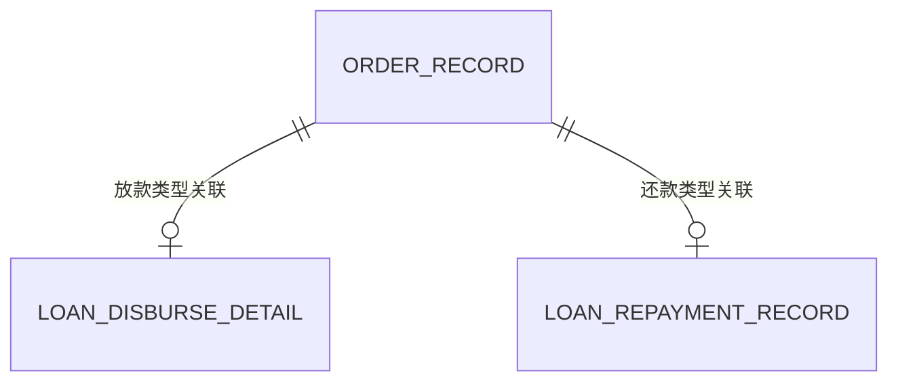

# 统一订单与放款/还款明细：阶段 8 分析稿

2026-10-13；状态：待业务和研发评审；只读代码观察 + 设计建议。版本清单见 `docs/baseline/12-phase8-real-requirement.md`，机器报告在 `var/reports/phase8-unified-loan-orders.json`。没有运行金融交易、数据库或业务测试。

## 1. 已确认范围

用户确认 DFBM 维护公共订单，本期接入放款与还款，其他交易类型后续接入。公共订单记录共性字段，各交易类型独立明细；未来提供统一订单记录查询。以下表名、字段和事务方案中，除“现状”外均为建议，不是用户已批准设计。

## 2. 证据目录与当前代码事实

下表路径均相对 DFBM 根目录，固定 commit 为 `b1b929fb71617aa9a324791d312b0bb47096a8f1`。七个文件本机内容与该 commit 相同。行号为本次读取位置；“表”表示代码引用，未查库确认已部署。

| 编号 | 路径与行号 | 代码观察 |
| --- | --- | --- |
| E01 | `dfbm-fbs/src/main/java/com/wefi/dfbm/fbs/txn/model/entity/OrderRecordDO.java:7–69` | 已有公共订单实体，六类业务枚举、订单号、业务类型/流水、用户、银行、金额、币种、状态等；注释约定类型+流水关联明细 |
| E02 | `dfbm-fbs/src/main/resources/mapper/OrderRecordMapper.xml:10–87` | 已有 order_record 插入、类型+流水查找、状态推进、用户+银行分页查询；SUCCESS/FAIL 不在成功更新的前置状态中 |
| E03 | `dfbm-fbs/src/main/java/com/wefi/dfbm/fbs/txn/service/impl/OrderRecordServiceImpl.java:35–88` | register/mark 方法捕获异常，仅记录日志；登记失败返回 null，重复登记返回已有订单号 |
| E04 | `dfbm-fbs/src/main/java/com/wefi/dfbm/fbs/txn/service/impl/LoanRepaymentServiceImpl.java:69–199` | 还款先查明细做状态裁决，调下游前登记明细和订单；结果分别更新两者；订单登记传入的币种为 null |
| E05 | `dfbm-fbs/src/main/resources/mapper/LoanRepaymentRecordMapper.xml:5–68` | 已有 loan_repayment_record；明细 markSuccess 允许 PROCESSING/FAIL/UNKNOWN；另有 resetToProcessing、未决扫描语句 |
| E06 | `dfbm-fbs/src/main/java/com/wefi/dfbm/fbs/txn/service/impl/LoanDisburseServiceImpl.java:25–47` | 放款入口绑定报价后调用 DcisLoanDisburseSao；该类中未见 OrderRecordService 或本地放款明细 Mapper 调用 |
| E07 | `dfbm-fbs/src/main/openapi/dfbm-fbs-api.yaml:140–260` | 当前 Provider 中含 repayLoan、disburseLoan、queryDisburseResult；与旧基线的接口/路由不可混用 |

补充 DCIS 证据：commit `4d02edad8e455506aeba0ee40dcd48f97076bf7b`，`dcis-mis/src/main/java/com/wefi/dcis/mis/service/impl/LoanTransactionServiceImpl.java:78–122,178–218`：放款编排和还款下游调用位于此处，明细标识登记仍属于 DCIS 既有职责。其记录不等同 DFBM 的用户公共订单。

限定负向检索：在上述 DFBM commit 对应的 `dfbm-fbs/src/main/java/**/*.java`，检索 `orderRecordService`、`OrderRecord`、`pageByUser`，订单业务写入调用命中还款服务，分页命中 Service/Mapper；本次未据此定位到对外订单查询 Controller。仅检查这些范围和模式，不宣称其他模块/版本没有实现。放款是否在切面或其他扩展点登记，仍需后续集成评审，不能仅凭 E06 证明全系统绝对未登记。

## 3. 知识记载、历史与用户决策

知识 snapshot：`git:060dc26a2d07b93482ee0a15bbeb016db17c116f`。

- K01：`02_knowledge/05_架构/2026-09-27_架构现状/一期业务与可靠性.md:1–13,36–54`，明确是“整理草稿、待审核、非上线证明”；记载同号同内容、未知先回查、短事务持久化、HTTP 在事务外，以及 DFBM outbox 建议。可作为方案参考，不能认定现代码已实现。
- K02：`02_knowledge/02_需求与规则/2026-09-27_首批需求/产品/PayTrigger_使用机制.md:51–59,70–77`，记载设备状态与真实资金/债务状态分离、未知先查原 Reference。本次仅作为产品文档记载，适用到本需求仍需业务核对。
- 历史实测：本次没有业务运行结果。旧 01100121 Golden 只证明当时产品查询案例，不证明当前放款/还款登记正确。
- 用户决策：本稿第 1 节。未决事项与建议均不提升为用户决策。

## 4. 差距和候选风险

| 项目 | 结论分类 | 依据与待验证结果 |
| --- | --- | --- |
| 公共表复用 | 建议 | E01–E03 已有实现，优先完善 order_record，避免另建第二套公共订单 |
| 放款接入 | 待补齐候选 | E06 的可见主路径未登记公共订单/放款明细；需要覆盖提交、响应、超时及结果回查 |
| 还款接入 | 已有部分实现 | E04/E05 有明细与订单写入，但不等同完整可靠性保证 |
| 漏单 | 风险推断 | E03 写失败继续业务；E04 同号重放/重复明细路径可能跳过公共订单登记，单靠后续重试不能保证补齐 |
| 状态分歧 | 风险推断 | E04 允许 FAIL 重试；E05 明细能 FAIL→SUCCESS，E02 公共订单不能。若同号失败后成功且没有额外修复，可能出现明细 SUCCESS、订单 FAIL |
| 已执行后的本地故障 | 风险推断 | E04 的 try 同时覆盖下游调用和本地 markSuccess；本地写异常也进入业务失败分类，需区分资金结果与本地持久化失败 |
| 未知状态收敛 | 覆盖缺口 | E05 有未决扫描 SQL；本次 Java 范围搜索仅命中 Mapper 声明，尚未定位执行恢复任务，不把 SQL 存在当作补偿已实现 |
| 币种 | 待确认 | E04 登记时传 null，未来跨交易统一金额展示必须明确币种来源 |
| 幂等隔离 | 待确认 | E02 类型+流水查询没有银行/调用方条件，E05 以还款流水查找；需确定流水全局唯一性及上层身份绑定，不直接认定越权漏洞 |

以上为静态路径分析，需要故障注入与并发测试验证；没有执行资金请求复现。

## 5. 建议数据模型

本期每笔已受理交易建议对应一行公共订单、一个对应类型明细；不能同时存在两种明细。图中的可选关系用于表达不同类型，不代表允许完成受理后缺明细。

| 对象 | 建议职责与字段 |
| --- | --- |
| 公共 order_record | 复用 orderNo、bizType、bizSeqNo、userId、bankCode、amount、currency、status、业务日期及创建更新时间；评估增加状态版本、完成时间和安全展示摘要 |
| 放款明细（候选名 loan_disbursement_record） | orderNo/业务关联键、放款流水、报价引用、产品/方案快照引用、放款金额及费用语义、借据号、下游引用、结果码、状态及恢复所需信息 |
| 还款明细 loan_repayment_record | 复用已有记录；评估 orderNo、币种、请求指纹及下游交易引用；本金/利息/费用分配仅在有权威结果时存储，不自行计算冒充下游结果 |

关联方式建议优先采用稳定 orderNo，并保留业务类型+业务流水去重键；若沿用现有复合关联，应通过明确唯一约束和应用校验保证一一对应。实际 DDL、外键/唯一键、索引需在后续允许读取迁移范围并实施时核对，本轮不假定已部署。

订单列表应只查询公共字段，按类型进入独立明细。未来新增交易类型增加其明细适配，避免公共表堆积大量贷款专属列。充值/提现/转账/支付只预留类型扩展，不声称已接入。

## 6. 建议受理、状态与恢复规则

候选流程：校验身份与业务参数 → 幂等判定 → 本地短事务同时保存订单和明细 → 事务外调用现有 DCIS → 本地短事务同步结果 → 未知/本地保存失败进入有持久化依据的恢复流程。

如果产品要求“受理成功必有订单”，建议本地登记事务失败时不发送新的资金命令。若公共订单被定义成异步查询投影，可以使用同事务持久化事件、幂等消费和对账补齐；仅 catch+日志不能满足最终完整性的验收。本建议尚待用户选择。

建议至少区分处理中、成功、确认失败、结果未知。未知先查原业务流水，不能自动换号再次放款/还款。必须明确 SUCCESS 的业务含义：核心记账、资金到账及用户展示成功是否是同一时点，不能自行以 HTTP 2xx 替代。

FAIL 是否允许同笔重试必须在主表和明细中一致。如果允许，设计明确的重试领取/版本条件，同时防止并发双发；如果 FAIL 为终态，则新尝试需关联原订单，并保留下游幂等边界。不能仅放宽一个 UPDATE 就认定问题解决。

同号同内容回放前校验银行、用户、目标借据、金额、币种、业务日期等规范化请求；同号异内容拒绝。成功后本地存储故障保留“待恢复”处理，不重新推断资金失败。结果回查或补偿只同步同一业务，不新增资金命令。

后续统一查询需服务端约束用户/银行归属、稳定分页（如时间+订单号游标）、类型化详情、状态口径和脱敏。不能把可调用的内部 Service 当成已完成对外授权接口。

## 7. 建议开发拆分与验收矩阵

| 任务 | 候选验收 |
| --- | --- |
| 复核表约束和明细关联 | 同一业务身份最多一公共订单、一对应明细；拒绝跨类型关联 |
| 放款接入 | 正常/拒绝/未知均可追溯订单与明细；不改变现有 DCIS/Fineract 职责 |
| 还款完善 | 同号重放不双写/双扣；已有缺失订单可按权威明细安全补齐 |
| 幂等并发 | 同号同体并发只一次下游执行；同号异体冲突；不同银行流水碰撞按已确认规则隔离 |
| 本地原子性 | 订单或明细写失败回滚本地登记；按已选策略证明未新增资金请求或存在持久化补偿 |
| 状态同步 | FAIL 后重试成功的主明细一致；迟到/重复响应不回退新状态 |
| 故障恢复 | 下游成功后本地写失败、超时、进程崩溃、回查暂未命中不误判失败、不重复资金操作 |
| 后续查询兼容 | 多交易类型共存，按用户/银行隔离；详情与类型一致；分页无越权 |

本轮没有执行上述业务验收。下一步应先确定写失败策略、重试语义、币种及历史回填范围，再实施 Java/迁移/业务测试。

## 8. 尚待确认

1. 公共订单是强制受理记录还是允许短时延迟的查询投影？写失败如何处理？
2. 同笔确认失败后的重试沿用订单还是建立尝试记录？
3. 是否回填历史订单；受理前参数校验失败是否展示在订单记录中？
4. 业务流水唯一性范围、币种来源、金额是本金/实到账/实扣哪个口径？
5. UNKNOWN 的自动回查、人工处理责任和时限由谁负责？
